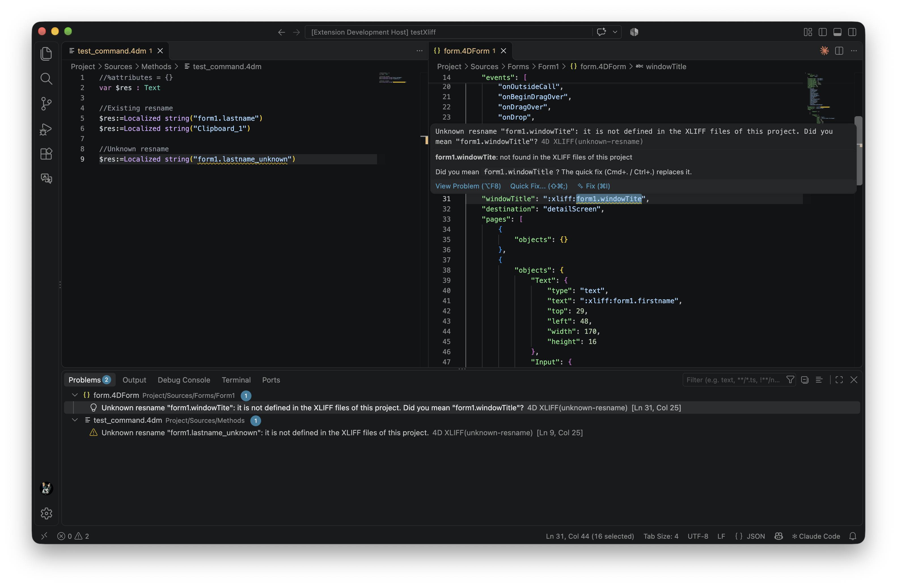
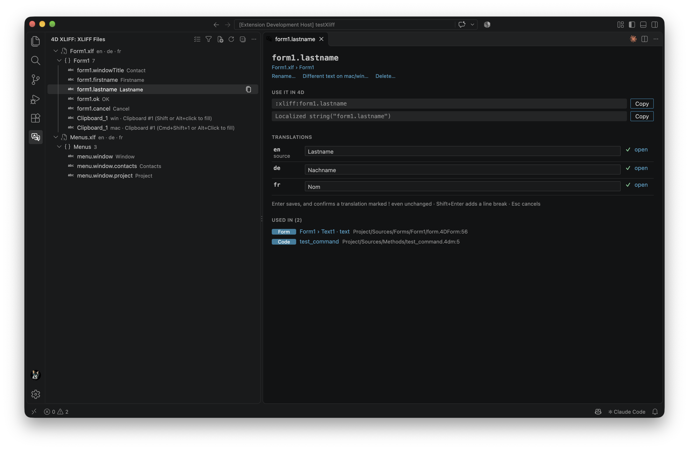

# 4D XLIFF Localization

Stop finding out at runtime that a form shows `:xliff:form1.lastname` instead of "Last name".

In a 4D project, forms, menus and code refer to translations by name: `:xliff:resname` or `Localized string("resname")`. A typo, a string missing in one language, or the same resname defined twice only shows up when the form is opened in that language. This extension checks every reference of the project against its XLIFF files while you edit, and gives you the exact reference to paste into 4D.

## Catch broken references before running

The Problems view lists, for the whole project:

- **Unknown resnames**: a `:xliff:` reference in a form, menu, choice list or help tip, or a `Localized string("…")` in a method, that no XLIFF file defines. This is what 4D displays as `:xliff:…` at runtime. When it looks like a typo of an existing resname (`form1.windowTite`, `form1.WindowTitle`), the message says "Did you mean `form1.windowTitle`?".
- **Strings missing in a language**: defined in `en.lproj` but not in `fr.lproj`, or present without a translation, or with an empty one.
- **Strings still to translate** (`state="needs-translation"`).
- **Duplicate resnames**: the same name in two files, where 4D uses only one of them.
- **Resnames that `:xliff:` cannot reference**: containing a space, or without a `resname` attribute.

Each problem has a fix at hand: the quick fix (Cmd+. / Ctrl+.) on an unknown resname replaces it with the existing resname it looks like, or creates it in every language, in the file and group holding its neighbours; the translations panel adds a missing string to a language in one click.

Resnames provided by 4D itself (`CommonMenuFile`, `CommonMenuItemQuit`…) are not reported as unknown, `translate="no"` strings as untranslated, nor the mac and win versions of a resname (`d4:includeIf`) as duplicates.

## Copy the reference instead of typing it

The XLIFF view in the activity bar lists every resname of the project, by file and group, with its text. The copy button next to a resname copies `:xliff:resname`, ready to paste into the Property List of the 4D form or menu editor; the context menu also copies `Localized string("resname")` for the code. A new string created from the view is copied at once.

## See each resname where it is used

- **In forms, menus, lists, tips and methods**: hover a reference to see its translations, Cmd/Ctrl+click to open its `trans-unit` in each language, and get resnames suggested after `:xliff:` and `Localized string("`.
- **In the XLIFF files**: a CodeLens above each `trans-unit` counts its usages, and "Find All References" lists them.
- **In the translations panel**: "Used in" lists the form objects (`Form1 › Button · text`), menus, lists, tips and methods using the resname.

## Edit the XLIFF files

Every change applies to all the languages at once, and only touches the text concerned: indentation, comments and attributes are kept as they are.

- **Translations panel** (click a resname): edit the source and each translation. Enter saves, and confirms a translation marked as needing translation even when it stays the same.
- **Add** a string or a group (`+` and context menu of the XLIFF view), or a file, created in each `<language>.lproj` and named like the other files of the project. New strings get the source text in every language, marked as needing translation, so that 4D never displays an empty label.
- **Rename** a resname: in every language and in all the forms, menus, lists, tips and methods referencing it, as one operation.
- **Delete** a resname from every language, after a confirmation listing the places still using it.
- **Add a language**: a copy of the source language files with every string to translate. The "to translate" view then lists only what remains, and Next / Cmd+Enter moves from one string to the next. To try a language in 4D, call `SET DATABASE LOCALIZATION("de")`.
- **mac/win versions** (`d4:includeIf`): each version is shown and edited separately; "Different Text on mac/win…" creates them.

## Settings

| Setting | Default | |
|---|---|---|
| `4dXliff.sourceLanguage` | (from the files) | Source language of the project |
| `4dXliff.ignoredResnames` | `["^Common"]` | Regular expressions of resnames provided by 4D |
| `4dXliff.excludeFolders` | `node_modules`, `DerivedData`, `Components`, `.git` | Folders ignored |
| `4dXliff.diagnostics.enabled` | `true` | Report problems |

## Known limitations

- The edits are written to the files: close the forms concerned in the 4D form editor before renaming a resname, so that 4D does not save over the change.
- Resnames containing spaces can only be used with `Localized string`, not in a `:xliff:` reference.
- Only `Resources/<language>.lproj` folders are read; an XLIFF file directly in `Resources` is ignored.
- References built at runtime (`Localized string($name)`) cannot be found.

## Commands

From the Command Palette, the XLIFF view title bar or its context menus:

- **4D XLIFF: Copy :xliff: Reference** — copies `:xliff:resname` for the 4D form or menu editor (copy button of a resname, or pick one by name).
- **4D XLIFF: Copy Localized string(…)** — copies `Localized string("resname")` for the code.
- **4D XLIFF: Show Translations…** — opens the translations panel of a resname.
- **4D XLIFF: Filter Resnames…** — shows only the resnames whose name or text contains a given text; **Clear Filter** shows them all again.
- **4D XLIFF: Show Strings to Translate…** — shows only the strings left to translate in a language, or in any language; **Leave the To Translate View** goes back to the whole list.
- **4D XLIFF: Add String…** — creates a resname in every language (`+` of a file or group, or quick fix on an unknown resname).
- **4D XLIFF: Add Group…** — creates a group in every language.
- **4D XLIFF: New XLIFF File…** — creates a file in each `<language>.lproj` folder.
- **4D XLIFF: Add Language…** — creates `<language>.lproj` from the source language files, every string marked as needing translation.
- **4D XLIFF: Refresh** — reads the XLIFF files and the 4D sources of the workspace again.

From the context menu of a resname in the XLIFF view:

- **Open in XLIFF File** — opens its `trans-unit` in the source language file.
- **Find Usages** — lists the forms, menus, lists, tips and methods using it.
- **Rename Resname…** — renames it in every language and in every reference of the project.
- **Different Text on mac/win…** — splits it into a win version and a mac version (`d4:includeIf`).
- **Delete Resname…** — removes it from every language.

## Contributing

See [CONTRIBUTING.md](CONTRIBUTING.md) for the source layout, tests and build instructions.

## License

[MIT](LICENSE)
